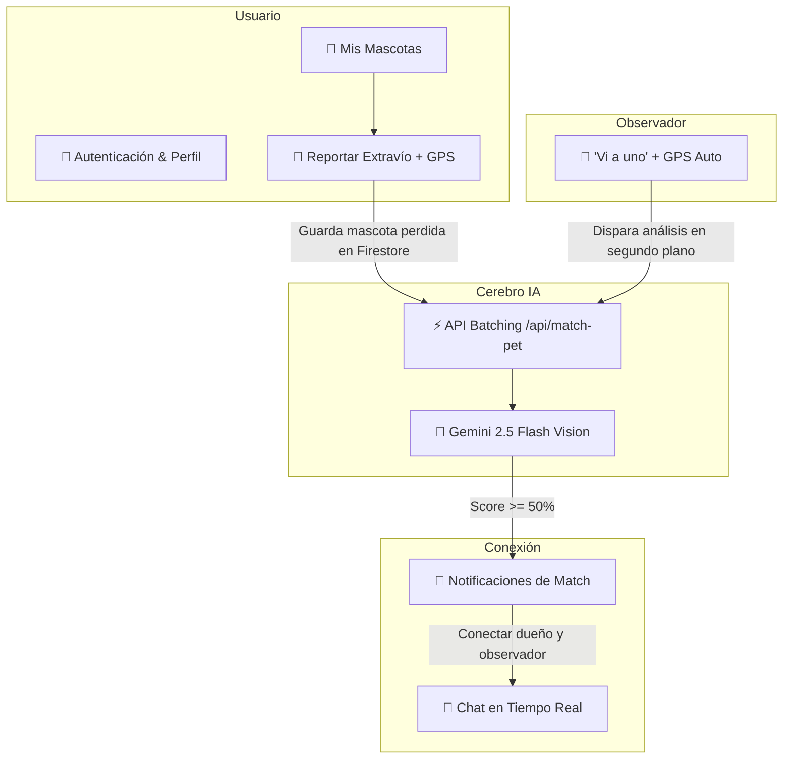

# 🐾 Pet Finder AI - Documentación de Funcionalidades y Estado del Proyecto

> **Versión Actual:** v0.6.4  
> **Última Actualización:** 2026-11-21  
> **Despliegue Producción:** Vercel (CI/CD conectado a rama `main` en GitHub)  
> **Stack:** Next.js 16 (App Router), React 19, Firebase Firestore & Auth, Google Gemini 2.5 Flash, Google Maps API.

---

## 📌 Resumen Ejecutivo
**Pet Finder AI** es una plataforma web y móvil diseñada para reunir mascotas extraviadas con sus familias mediante el uso de **Inteligencia Artificial Multimodal (Gemini 2.5 Flash)**, **Geolocalización GPS en tiempo real**, **Notificaciones automáticas** y un **Sistema de Chat en vivo**.

---

## 🗺️ Mapa de Módulos y Funcionalidades



---

## 1. 🔐 Autenticación y Perfil (`/auth`, `/profile`)
- **Métodos de Acceso:**
  - Correo electrónico y contraseña.
  - Inicio de sesión con un clic vía **Google Sign-In**.
  - Persistencia de sesión global mediante `AuthContext`.
- **Gestión de Perfil:**
  - Visualización del nombre de usuario, avatar y correo electrónico.
  - Botón de cierre de sesión seguro.
  - Indicadores del estado de sesión en toda la navegación.

---

## 2. 🐕 Gestión de Mascotas ("Mis Mascotas" - `/pets`)
- **Registro de Mascotas Propias:**
  - Formulario con nombre, especie (perro, gato, otro), raza, edad y rasgos especiales.
  - Carga de fotografía con **compresión automática en el navegador** (`imageUtils.js`) para acelerar la subida y optimizar consumo de red y almacenamiento.
- **Visualización y Estados:**
  - Tarjetas individuales de cada mascota registrada.
  - Insignia de estado: `En casa` (verde) o `Extraviado` (rojo).
- **Reportar Extravío con GPS Automático (Modal):**
  - Botón directo *"Reportar Extravío"* en la tarjeta de la mascota.
  - **Geolocalización GPS automática:** Al abrir el modal, la app detecta instantáneamente la posición actual del usuario mediante el navegador y centra el mapa con un marcador en su ubicación real.
  - **Google Maps Picker:** Permite mover o afinar el marcador en el mapa interactivo.
  - Campo de fecha de extravío y referencias del lugar (ej. *"Frente al parque"*).
  - Al cerrar el modal, los datos se limpian para permitir una nueva consulta fresca.

---

## 3. 🚨 Reporte Rápido de Mascota Extraviada (`/lost`)
- Flujo dedicado y simplificado accesible desde la barra de navegación o página de inicio.
- Permite seleccionar cuál de las mascotas registradas se extravió y registrar el evento con selector de mapa y fecha.

---

## 4. 👁️ Reporte de Avistamientos ("Vi a uno" - `/spotted`)
- Diseñado para cualquier usuario que vea una mascota sola o en situación de calle.
- **Carga de Fotografía Rápida:**
  - Optimizado para tomar la foto directamente con la cámara del celular o galería.
  - Compresión previa a la subida.
- **Geolocalización Inmediata:**
  - Detecta la ubicación del observador en segundo plano mediante GPS de alta precisión.
  - Centra el mapa de Google Maps automáticamente en las coordenadas detectadas.
- **Historial de Avistamientos del Usuario:**
  - Pestaña para revisar todos los reportes hechos por el usuario.
  - **Estados dinámicos:**
    - `🧠 Analizando...`: El reporte está en la cola de procesamiento de la IA.
    - `🎯 Coincidencia encontrada`: Se identificó al menos una mascota extraviada similar.
    - `✅ Sin coincidencias`: Se procesó y no hubo coincidencias superiores al umbral.

---

## 5. 🧠 Motor de Matching con Inteligencia Artificial (`/api/match-pet`)
El núcleo tecnológico más avanzado de la plataforma:
- **Modelo:** `gemini-2.5-flash` de Google Cloud Vertex / Google Generative AI (multimodal: analiza imágenes y texto simultáneamente).
- **Ejecución en Segundo Plano no bloqueante:**
  - Utiliza la función `after()` de Next.js 16 para responder al usuario en milisegundos y continuar ejecutando la comparación pesada de fotos en segundo plano sin interrumpir la interfaz.
- **Procesamiento por Lotes (Batching de 100 fotos):**
  - Compara la foto de la mascota avistada contra hasta **100 fotos de mascotas perdidas en una sola llamada a Gemini**.
  - Ahorro drástico de llamadas a la API, tiempo y consumo de tokens.
- **Respeto a Rate Limits (5 TPM):**
  - Pausas calculadas (`13 segundos`) entre lotes si hay más de 100 mascotas perdidas, garantizando que nunca se sobrepase el límite de la cuota gratuita.
- **Umbral de Coincidencia Calibrado al 50%:**
  - Diseñado para condiciones del mundo real: fotos tomadas desde autos en movimiento, ángulos inclinados, iluminación precaria o mascotas mojadas/sucias.
  - Si Gemini califica con **50% o más**, se considera potencial coincidencia y se notifica al dueño.
- **Explicación Razonada:**
  - Gemini devuelve un porcentaje y una justificación en español explicando los rasgos comparados (pelaje, manchas, orejas, fisonomía).

---

## 6. 🔔 Sistema de Notificaciones Inteligentes (`/notifications`)
- Centro de notificaciones sincronizado con Firebase Firestore.
- Contador de notificaciones no leídas con insignia en la barra de navegación.
- **Tarjetas de Coincidencia:**
  - Muestra la foto de la mascota avistada.
  - Porcentaje de coincidencia (ej. `92%`).
  - Razón detallada generada por Gemini.
  - Ubicación y fecha del avistamiento.
  - **Botón "Contactar a quien lo vio":** Redirige directamente al chat privado con el observador.
- Opción para *"Marcar como leídas"*.

---

## 7. 💬 Chat en Tiempo Real estilo WhatsApp (`/chat`)
- **Arquitectura de Mensajería:**
  - Basada en listeners en tiempo real (`onSnapshot`) de Firebase Firestore.
  - Envío y recepción instantánea de mensajes entre el dueño y quien reportó el avistamiento.
- **Diseño Mobile-First (WhatsApp Experience):**
  - **En computadoras:** Diseño split-screen (lista de conversaciones a la izquierda, ventana de chat activa a la derecha).
  - **En teléfonos móviles:**
    - Al abrir una conversación, toma el **100% de la pantalla**, ocultando barras de menú (`chat-active`).
    - Botón de navegación táctil `← Volver` en la cabecera.
    - Cero distracciones con el teclado virtual desplegado.
- **Enlace directo:** Soporta parámetros URL (`/chat?with=<userId>`) para abrir una conversación instantánea desde una notificación de coincidencia.

---

## 8. 📱 Experiencia de Usuario y Diseño Adaptativo
- **Bottom Navigation Bar (Móvil):**
  - Barra de navegación anclada en la parte inferior de la pantalla para fácil acceso con los pulgares en smartphones.
  - Íconos SVG ultra-ligeros con estados activos.
  - Botón de alerta roja `!` destacado para reportar extravíos con urgencia.
- **Navegación Desktop:**
  - Barra superior elegante con accesos directos a Mensajes, Notificaciones, Mis Mascotas y Perfil.

---

## 🛠️ Tecnologías y Dependencias Principales

| Componente | Tecnología | Versión |
| :--- | :--- | :--- |
| **Framework Web** | Next.js (App Router) | `16.2.1` |
| **Biblioteca UI** | React / React-DOM | `19.2.4` |
| **Base de Datos & Auth** | Firebase (Firestore + Auth) | `^12.11.0` |
| **Inteligencia Artificial** | `@google/generative-ai` (Gemini 2.5 Flash) | `^0.24.1` |
| **Mapas & Geocodificación** | Google Maps JavaScript API (`@react-google-maps/api`) | `^2.20.8` |
| **Optimización de Imágenes** | Canvas API Nativo (`imageUtils.js`) | Nativo |
| **Hosting y CI/CD** | Vercel Serverless Platform | Producción |

---

## 📂 Estructura de Rutas de la Aplicación

```text
app/
├── api/
│   └── match-pet/route.js     # API de IA en segundo plano (Gemini 2.5 Flash + after())
├── auth/page.js               # Login y Registro (Email + Google)
├── chat/page.js               # Chat en vivo móvil/desktop
├── lost/page.js               # Reporte rápido de extravío
├── notifications/page.js      # Centro de alertas de coincidencias
├── pets/page.js               # Gestión de mis mascotas + modal con auto-GPS
├── profile/page.js            # Perfil de usuario y sesión
├── spotted/page.js            # Formulario "Vi a uno" + auto-GPS + historial
├── layout.js                  # Layout raíz y proveedores de contexto
└── page.js                    # Landing page informativa
```
